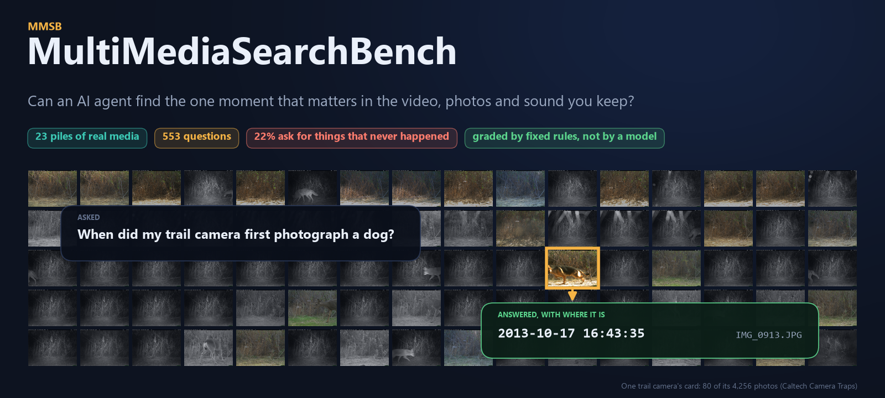
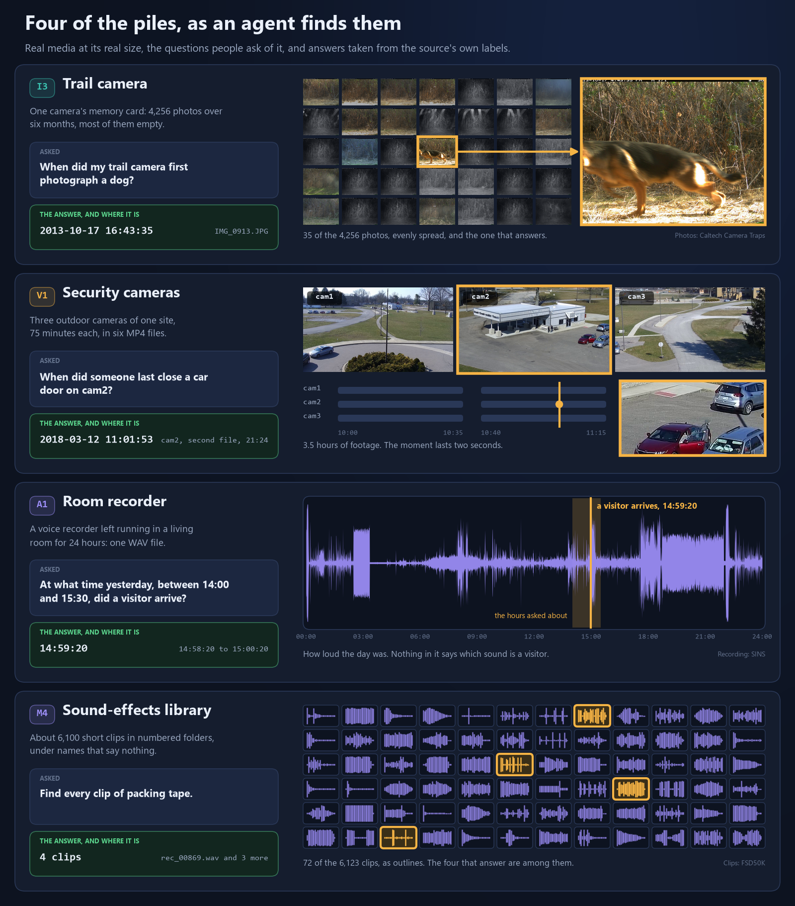
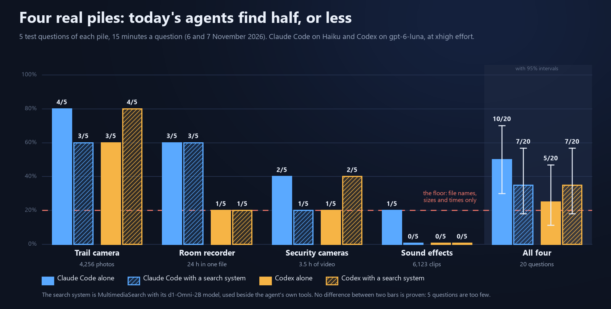
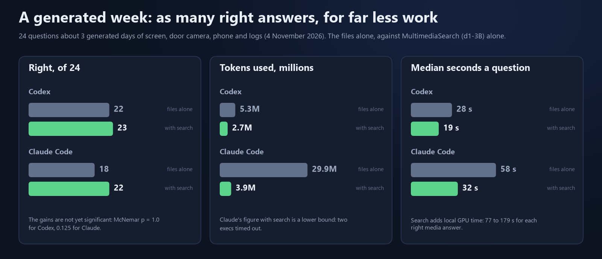
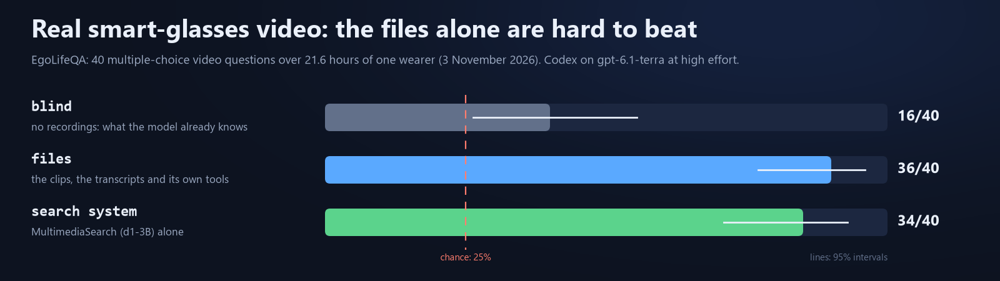
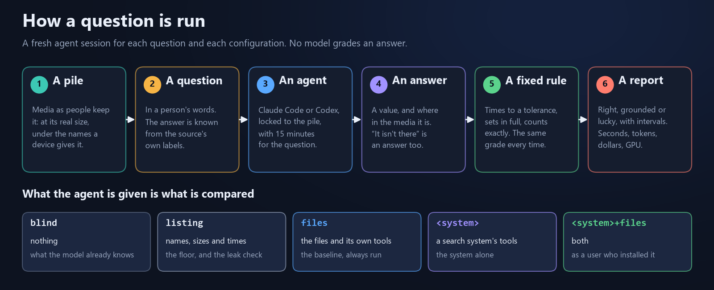
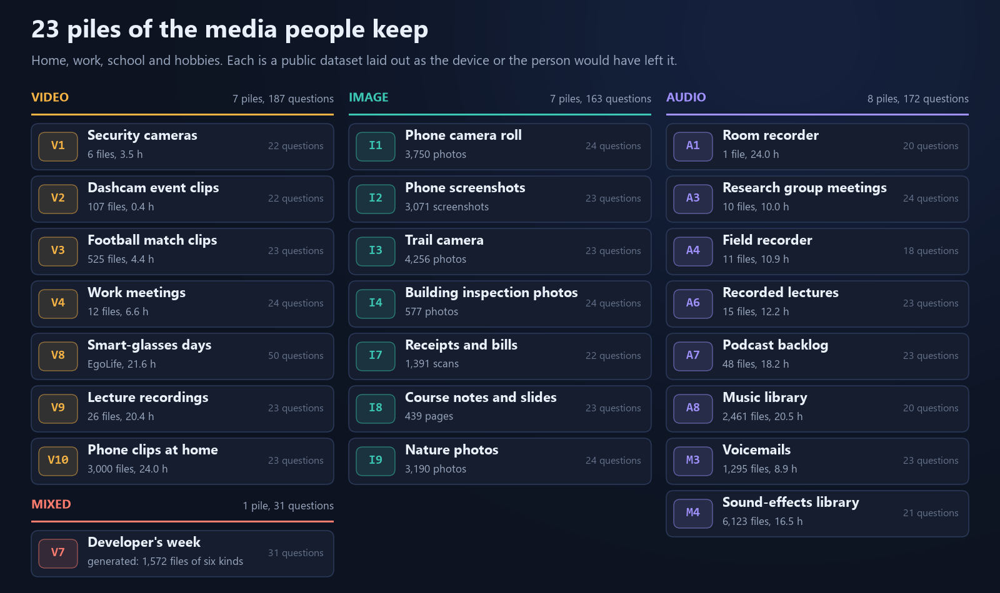

<p align="center">
  
</p>

<p align="center">
  <a href="https://github.com/DanMcInerney/MultiMediaSearchBench/actions/workflows/test.yml"></a>
  
  
  <a href="LICENSE"></a>
  <a href="https://huggingface.co/datasets/DanMcInerney/mmmb-sources"></a>
</p>

# MultiMediaSearchBench (MMSB)

**MMSB tells people how well an AI agent can find things in their own large piles of video, pictures and sound, and which
search tools make it better, judged on the media people really keep and the questions they really ask.**

People keep footage from security cameras, phones, dashcams, meetings, labs and field recorders, and they rarely look at it
again, because finding one moment in it takes hours. An agent that can be told "find when the parcel was taken" can change
that. MMSB measures how close agents and their tools are to doing it well.

- **Neutral.** Any agent and any search system can be measured. The agent working alone with the files is always the baseline.
- **Right means shown to be right.** An answer counts as grounded when it points to where in the media the answer is. Every
  answer is known in advance and checked by fixed rules, not by another model.
- **"It isn't there" is an answer.** About a quarter of the questions ask for things that never happened.
- **Cost is part of the result:** time, tokens and dollars, the local GPU seconds, and the wait before a pile can be searched.
- **Honest numbers.** Results say how sure they are, and small differences are called unproven.

**Contents:** [What a question looks like](#what-a-question-looks-like) · [Results](#results) · [How it works](#how-it-works) ·
[The catalogue](#the-catalogue) · [Quick start](#quick-start) · [Commands](#commands) ·
[Measuring another system](#measuring-another-system) · [Tests](#tests) · [Status](#status-and-limits) · [Credits](#credits)

## What a question looks like

Each pile is a public dataset laid out as the device or the person would have left it: a memory card, a camera export, one
long recording, a folder of clips under names that say nothing. The agent gets the pile, one question and 15 minutes.

<p align="center">
  
</p>

The four above are the piles that have been run with real agents. The examples are `dev` questions, and their answers come
from the datasets' own labels.

## Results

Three runs have been made so far. All are small, and each says so.

### Four real piles (6 and 7 November 2026)

<p align="center">
  
</p>

Each agent was asked 5 `test` questions of each pile (`--splits test --limit 5`, seed 1, full size) with 900 s for each. Claude
Code ran Haiku at `xhigh` effort and Codex ran `gpt-6-luna` at `xhigh`. `files` is the agent alone with the files and its own
tools. `mm+files` adds [MultimediaSearch](https://github.com/DanMcInerney/MultimediaSearch) with its `d1-Omni-2B` model, which
sees and hears.

| Pile | The 5 questions | Claude, `files` | Claude, `mm+files` | Codex, `files` | Codex, `mm+files` |
| --- | --- | --- | --- | --- | --- |
| `i3_trailcam` | 2 which-days, 1 count, 1 first, 1 absent | 4/5 | 3/5 | 3/5 (1 lucky) | 4/5 (1 lucky) |
| `a1_home_audio` | 2 start times, 1 stop time, 1 count, 1 absent | 3/5 | 3/5 | 1/5 | 1/5 (lucky) |
| `v1_security` | 2 first, 1 last, 1 count, 1 absent | 2/5 | 1/5 | 1/5 | 2/5 |
| `m4_samples` | 2 find-every-clip, 2 count, 1 absent | 1/5 | 0/5 (all timed out) | 0/5 (all timed out) | 0/5 (all timed out) |
| **All four** | 20 | **10/20**, all grounded | **7/20**, all grounded | **5/20**, 4 grounded | **7/20**, 5 grounded |

- **The task is far from solved.** The better agent found half. Nobody could work through 6,123 unnamed sound clips in 15
  minutes, with or without a search system.
- **Nothing here ranks the agents or the search system.** With 5 questions a cell's 95% interval spans about 60 points. No
  pile's pair of cells differs by more than one question, and every McNemar p is 1.0.
- **No leaks.** Given only the files' names, sizes and times (`listing`), both agents answered "unknown" to all 20: right
  only on the 4 absent questions, as they should be.
- **Time ran out often.** Codex timed out on 7 of its 20 `files` questions (mean exec 615 s). Claude timed out once and hit
  its 60-turn cap twice. With `mm+files`, Claude timed out on 7 and Codex on 7.
- **Cost.** Claude's `files` execs came to $8.07 at list price and its `mm+files` execs to $2.93, a lower bound, because an
  exec that times out records no tokens. Codex reports no cost.
- **The wait before a pile can be searched.** Ingesting into MultimediaSearch took 20 s to 284 s for each pile and wrote 1.9 GB
  to 5.8 GB. The baseline needs none.
- **Read with these.** The agents were not told the 900 s (the prompt now states the limit, so a later run is
  not like for like). Claude's `files` figure for `m4_samples` is a rerun, after its prompt was fixed to name two limits of its
  shell tool. The GPU dropped off once during the `mm+files` execs: the run was resumed and the exec asked again.

The reports, with a row for every question: [files and listing](results/2026-11-06-baseline/) and
[with the search system](results/2026-11-07-search-tool/).

### A generated week, with and without a search system (4 November 2026)

<p align="center">
  
</p>

24 questions about 3 generated days of a developer's screen, door camera, phone, microphone and logs (scenario `v7_screen`), where every needle is planted among
decoys. Each agent answered once with the files alone and once with only MultimediaSearch's tools (`d1-3B`, which sees but
does not hear).

| Agent | Right, files alone | Right, with search | Media questions | Median time | Tokens | Cost |
| --- | --- | --- | --- | --- | --- | --- |
| Codex (`gpt-6.1-terra`, medium effort) | 22/24 | **23/24** | 14/16 → 15/16 | 28 s → 19 s | 5.3M → 2.7M | not reported |
| Claude Code (`claude-sonnet-5-5`) | 18/24 | **22/24** | 10/16 → 14/16 | 58 s → 32 s | 29.9M → 3.9M (a lower bound) | $13.48 → $2.70 |

- The search system never cost a right answer, and video is where it helped: Claude went from 3/9 to 7/9 on video.
- It adds local GPU time: 77 to 179 GPU seconds for each right media answer.
- The gains are not yet significant (McNemar p = 1.0 and 0.125), and planted needles are easier to filter for than real ones.

Read it in [its own write-up](results/2026-11-04-generated-week/README.md), which shows four questions side by side: how each
agent went about them, and what each cost.

### Real smart-glasses video: EgoLifeQA (3 November 2026)

<p align="center">
  
</p>

Codex (`gpt-6.1-terra`, high effort) answered 40 multiple-choice video questions about 3 days of one wearer's
[EgoLife](https://huggingface.co/datasets/lmms-lab/EgoLife) recordings (2,592 clips, 21.6 hours), each asked as of its own time.

- **Blind is the floor:** 16/40 with no recordings at all, which is what the model already knows of a public dataset.
- **The search system tied with the files** (34 against 36, McNemar p = 0.75) and used twice the tokens for each right answer.
  On this data the transcripts carry most answers.

The [full report](results/2026-11-03-egolife/report.md) has every table.

## How it works

<p align="center">
  
</p>

A configuration is what an agent is given for one run of a question. It is written `blind`, or `<system>[/<variant>][+files]`.

| Written | The agent has |
| --- | --- |
| `blind` | no tools and no recordings: what the model already knows |
| `files` | the files and its own tools (shell, file reads, ffmpeg): the baseline |
| `listing` | the listing of the files' names, sizes, times and metadata: the floor, and a leak filter |
| `mm` (`mm/d1-3B`) | MultimediaSearch's tools only: `find`, `ask`, `look`, `label` |
| `mm+files` (`mm/d1-3B+files`) | its own tools and MultimediaSearch's, as a user who has installed it has them |

- **Agents:** Claude Code and Codex, each locked to the pile: no network, no answer key, no other question's working folder.
  A command that reaches outside ends the question as `escaped`, which is graded wrong.
- **Systems:** `files`, `listing`, and any plug-in search system. `mm` is one and is optional. Its default variant is `d1-3B`,
  which does not hear, so `mm` alone is asked only the questions about pictures, video, text and records. `mm/d1-Omni-2B`
  hears and is asked them all.
- **Grading:** a rule for each kind of answer (a time within a tolerance, a set of files or dates, a count, a value read or
  heard, "not there"). A right answer that cites where it is in the media is *grounded*; one that does not is *lucky*.
- **Leaks:** every build runs a shortcut probe, and any question that `listing` answers is reported and left out of every
  other figure.
- **Statistics:** Wilson intervals on every proportion and McNemar's test on every pair. A difference is shown only when p is
  under 0.05.

[DESIGN.md](DESIGN.md) has the whole design and [VISION.md](VISION.md) what it must stay true to.

## The catalogue

<p align="center">
  
</p>

23 piles for home, work, school and hobbies, and 553 questions. [CATALOGUE.md](CATALOGUE.md) lists every pile with where it
is from and gives example questions for each category. [MEDIA.md](MEDIA.md) gives each source's licence and credit.

<p align="center">
  
</p>

About 30% of each pile's questions are `dev`, for tuning a system. The rest are `test`.

## Quick start

Needs Python 3.12 and [uv](https://docs.astral.sh/uv/), on Windows, Linux or macOS. A real run also needs the Claude Code and
Codex CLIs signed in (the runs use your plans' quota) and, on Windows, Git for Windows (Claude's shell tool needs it). The
commands are the same on each system: only the paths differ (`<home>\mmsb-runs` here is `<home>/mmsb-runs` off Windows).

```
uv sync
uv run mmsb fetch --scenario i3_trailcam
uv run mmsb build --scenario i3_trailcam --scale tiny --configs files,listing
uv run mmsb run <run> --agents claude,codex --configs files,listing --dry-run
uv run mmsb run <run> --agents claude,codex --configs files,listing
uv run mmsb report <run>
```

- `fetch` downloads just what the build reads (1.9 GB for the trail camera) and needs no account.
- `build` copies the pile into a dump with its recording times, writes the questions, ingests the dump for the systems among
  `--configs` and runs the leak probe. It prints the run folder, `<home>\mmsb-runs\<date>-i3-tiny-s1`: `<run>` is that folder
  or its bare name. `--scale tiny` is a few files and 6 to 8 questions, built in seconds. `--scale standard` is the full pile.
- `run --dry-run` says what the run will cost and starts no agent. Without it the run spends your plans' quota, and stops when
  a plan is at 95% of its use. A run that stopped is continued by the same command.
- `report` writes `report.md` and `report.json` in the run folder.

<details>
<summary><b>More on building, running and reporting</b></summary>

- `--scenario` is any ID of the catalogue (`v1_security`, `i3_trailcam`, `a1_home_audio`, `m4_samples`, ...) or the extras
  `v7_screen` and `v8_egolife`. `--seed N` draws other questions from the same pile. A full-size dump is built in minutes and
  is found again by the next build of the same recipe.
- A run built with `--out` elsewhere is named by its folder: a bare name is looked for only in the default runs folder.
- `--jobs` is how many execs of a configuration run at once (3 unless you say, at most 4). A configuration whose system needs
  the GPU (`mm`) runs one at a time whatever `--jobs` says, and only `--gpu-jobs N` asks for more. `--limit 12` or
  `--kinds count,absent` run fewer cases.
- The report gives, for each agent and configuration: what it got right with its interval, grounded and lucky answers, absent
  questions answered, seconds, tokens and dollars per right answer, the questions `listing` answered (leaks, left out of every
  other figure), and each other configuration beside `files`. Several runs of one real scenario (other seeds) are pooled, and
  runs of several scenarios get a table over all of them.
- `run` never ingests: a configuration whose system has no store in the run is refused, with the `mmsb ingest` command to make
  it.

</details>

<details>
<summary><b>Where things go</b></summary>

`MMSB_HOME` (default: your home folder) holds everything MMSB makes:

| Folder | Holds | Changed with |
| --- | --- | --- |
| `mmsb-runs` | a run's folder | `--out` |
| `mmsb-data` | the prepared dumps and the agents' working folders | `--temp` |
| `mmsb-cache` | the dumps' records and the ingested stores | `--cache` |
| `mmsb-temp` | where the tests keep theirs | |

- The first three must be on one drive, because a store is copied with hard links.
- `--out` must not hold `--temp` (not your home folder, not a drive's root, when the default temp folder is in it). An agent is
  refused the folder its run is in, so that it cannot read the runs beside its own, and `build` stops at once when that would
  be its own data folder as well.
- `mmsb-data` may hold only runs' folders, as an agent with its own tools can list it.

</details>

<details>
<summary><b>The sources: where they are kept and how to get them</b></summary>

The sources are in the folder `MMSB_SOURCES` names, else `mmsb-sources` in the MMSB home, one folder per source (`meva`,
`caltech-camera-traps`, `sins`, `fsd50k`, ...). A build reads them and never writes there. Agents are refused any command or
output that names the sources folder (or its parent, when it is called `sources`), so name it with 6 or more letters that no
tool prints, such as `mmsb-sources`.

**Fetch them.** `mmsb fetch` downloads just what each build reads and says when what it found is not what the build needs. It
resumes: run the same command again after a stop, and a file that is there with the right size is left alone. It waits as a
server asks (429, Retry-After) and asks for four files at a time.

```
uv run mmsb fetch --scenario i3_trailcam     # or another scenario of the catalogue; repeat the flag, or --scenario all
```

To keep the sources elsewhere, set `MMSB_SOURCES` first, in the shell that runs `fetch` and in the one that runs `build`
(`$env:MMSB_SOURCES = "D:\data\mmsb-sources"` in PowerShell, `export MMSB_SOURCES=/data/mmsb-sources` in bash). `fetch --sources
DIR` only says where that fetch writes: a build reads `MMSB_SOURCES`, and `fetch` says so when the two differ.

| Scenario | Source | Downloaded (kept) | Licence |
| --- | --- | --- | --- |
| `v1_security` | MEVA: 42 clips of three cameras and their labels | 5.8 GB | CC BY 4.0 |
| `i3_trailcam` | Caltech Camera Traps: the labels and 4,256 photos | 1.9 GB | CDLA-Permissive 1.0 |
| `a1_home_audio` | SINS: node 7's 1,441 minute files of one day and the labels | 4.9 GB read from Zenodo (3.3 GB kept as FLAC) | academic research only; may not be passed on |
| `m4_samples` | FSD50K: the evaluation split's 10,231 clips and its labels | 8.8 GB | CC BY 4.0; each clip has its own, some non-commercial |

These four come to about 21 GB read and 20 GB kept. The label files come from fixed commits of their repositories (the Hugging
Face mirror's, for FSD50K), so the answers do not change under a published result. [MEDIA.md](MEDIA.md) has the other piles.

**SINS's licence forbids passing the data on, so `mmsb fetch` downloads it from Zenodo for you, to use under that licence, and
says so when it starts. Never copy it anywhere others can fetch it from.**

V7 needs no source (it is generated). V8's EgoLife download is yours to make ([MEDIA.md](MEDIA.md)): give its folder to
`mmsb build --scenario v8_egolife --source DIR`.

**Or download them together.** [DanMcInerney/mmmb-sources](https://huggingface.co/datasets/DanMcInerney/mmmb-sources) on
Hugging Face holds the sources of 16 of the 23 scenarios (52 GB), one folder per source, as the builders read them. Download
it into your sources folder, or add `--include "caltech-camera-traps/*"` for one source:

```
hf download DanMcInerney/mmmb-sources --repo-type dataset --local-dir D:/mmsb-sources
```

Its card gives each folder's licence, and many are for non-commercial use only. The sources of six scenarios are not in it, and
the card says why and where to get them.

</details>

<details>
<summary><b>Windows only: Codex's sandbox and folder names</b></summary>

Codex's sandbox on Windows opens the data files through the permissions their folder gives them (`mmsb` resets each file to
those and refuses one with permissions of its own). A folder under your user profile gives them to you, SYSTEM and
Administrators only, while the root of a drive gives `Users` read. So with the default home Codex's sandbox may be unable to
open the data: if it answers every question "unknown", set `MMSB_HOME` to a folder directly under a drive's root, such as
`C:\mmsb` or `D:\` (this is read from the permissions and has not been run with Codex). Claude Code runs as you and is not
affected.

Keep this repository's folder from having a name that begins like one of the data folders (a clone called `mmsb` beside
`mmsb-data`): a run is refused, naming the folder, when its data folder's path holds the checkout's.

</details>

<details>
<summary><b>Running the <code>mm</code> system (MultimediaSearch, needs an NVIDIA GPU)</b></summary>

```
uv sync --extra mm                   # MultimediaSearch (`mms`), for the mm system
uv sync --extra mm --group mm-gpu    # also torch and transformers, to run its real decision model
```

Then pass `--configs files,mm` (or `mm+files`, `mm/d1-Omni-2B+files`) to `build` and to `run`.

- The `mm` extra is a direct reference to [MultimediaSearch](https://github.com/DanMcInerney/MultimediaSearch) at one commit
  (`pyproject.toml`, which `uv.lock` pins as well), so it needs the network and no checkout of it.
- The model's weights are looked for in `MMS_MODELS`, else `~/.mms/models`, which is where `mms model use <name>` puts them.
- `mm` runs one exec at a time, because it needs the GPU and the maintainer's laptop driver crashed under three at once.
  `--gpu-jobs 2` asks for more, and until MultimediaSearch reports its queue the working clock refuses it (`--clock wall`
  lets it through, with a warning).
- `uv sync` is exact: it removes an extra you do not ask for. `uv run` does not remove what is installed.
- The benchmark's own name for the system stays `mm`: configurations like `mm+files`, folders like `mm-d1-3B`.

The libraries that write the V7 week are pinned, because its bytes depend on them. ffmpeg comes with `imageio-ffmpeg`.

</details>

## Commands

Each has `--help`.

| Command | Does |
| --- | --- |
| `mmsb fetch` | downloads the sources a scenario's build reads |
| `mmsb catalogue` | prints [CATALOGUE.md](CATALOGUE.md), made from the scenarios themselves |
| `mmsb build` | writes a scenario's dump and questions (or finds them cached), ingests the systems named, probes for shortcuts |
| `mmsb ingest RUN` | ingests the dump into the stores of more systems |
| `mmsb run RUN` | the execs of Claude and Codex over the questions; resumes; `--dry-run` prices it |
| `mmsb retrieve RUN` | each system asked for the needles with no agent (the GPU, alone) |
| `mmsb report RUN [RUN ...]` | figures and Markdown; runs of one real scenario (or of V7) are pooled, V8's are reported one at a time, and runs of several scenarios get a table over all |
| `mmsb compare A B` | two runs of the same questions, cell by cell: the flips, the counts, McNemar |
| `mmsb repeat RUN` | a run made again: the same recipe, agents, models and efforts, then `compare` |
| `mmsb clock-check RUN --config CONFIG` | the working clock tried on a few cases, each asked alone and then queued (not run yet) |

## Measuring another system

A system is a folder under `mmsb/systems/` with a `system.toml` and a class. The registry reads every `system.toml` and imports
a class only when a configuration names its system, so a new system changes nothing else.

1. Make `mmsb/systems/<name>/` with a `system.toml`: its name, its class, the pyproject extra and group it needs, its licence,
   its default variant, whether it reads the data as it is (`view`) or cut to each question's time (`cut`), and the
   `[isolation]` that keeps an agent off its home. `mmsb/systems/listing/` is the smallest one with a server of its own, and
   `mmsb/systems/__init__.py` lists the keys. Put its dependencies in an extra of `pyproject.toml`.
2. Write the class. It gives `describe`, `ingest`, `open` (a session that serves the agent's tools, and audits, resets and
   reports the cost of each case) and `check_ready`; `preview` and `oracle` are optional.
3. Run it: `--configs files,<name>` (or `<name>+files`, which also gives the agent its own tools) on `build` and on `run`.

DESIGN.md section 3.1 has the contract and the rules a system follows: ingest sees no question, instructions are general, no
network unless hosted, GPU work goes through the runner.

## Tests

```
uv run pytest
```

runs the fast tests (about 1,400, in about 6 minutes at 4 workers) with no agent, no GPU and no network. The tests of the real
scenarios read the sources and skip, saying so, where `MMSB_SOURCES` has none. Without the `mm` extra the tests in `tests/mm`
skip, and say so in the summary. CI runs them on Windows, Linux and macOS for each push to main and each pull request.
[TESTING.md](TESTING.md) has the markers and the commands for the slow ones.

## Where things are

| Path | What |
| --- | --- |
| `mmsb/core/` | the runner, the agents (`agents/`), grading, the reports. It imports and names no system (`tests/test_neutral.py` checks it) |
| `mmsb/systems/` | `files/`, `listing/`, `mm/`, each with a `system.toml` |
| `mmsb/scenarios/` | `realdump/` (the builder the real scenarios share) and one folder for each scenario of the catalogue |
| `mmsb/fetch.py`, `mmsb/fetch_piles.py` | `mmsb fetch` |
| `mmsb/catalogue.py` | `mmsb catalogue` |
| `tests/` | the tests |
| `results/` | the published reports |
| `docs/` | this README's figures (`img/`) and the script that draws them (`figures.py`) |
| [VISION.md](VISION.md) | what MMSB is for and what it must stay true to |
| [DESIGN.md](DESIGN.md) | how it is built and what is measured |
| [CATALOGUE.md](CATALOGUE.md) | every pile, and example questions of every category |
| [MEDIA.md](MEDIA.md) | where each pile's media comes from, under what licence, and what is taken from it |
| [TESTING.md](TESTING.md) | how the benchmark is tested |

## Status and limits

- **Run with real agents:** four of the 23 piles, 5 questions each (above), a tiny smoke run of the trail camera, the generated
  week and EgoLifeQA. No pile has had a full run: those cost real quota and are next.
- **Built and tested without agents:** the other 19 piles. Their builders, questions and graders are tested, but no agent or
  search system has answered them yet.
- **Agents have only been run on Windows 11.** On Linux the tests pass, a pile builds and a run is priced (`--dry-run`), and CI
  runs the tests on Linux and macOS as well. No real agent exec has been made off Windows, so Codex's sandbox and Claude's shell
  tool are untried there.
- **Two agents:** Claude Code and Codex. Another is a module in `mmsb/core/agents/`.
- **One search system so far:** MultimediaSearch, by the author of this benchmark. The core names no system, and a second one
  is the best check of that: see [Measuring another system](#measuring-another-system).
- **Not run yet:** the working-time clock (`mmsb clock-check`) and more than one GPU exec at a time.

## Credits

MMSB publishes no media. Every pile is built from a dataset its publisher hosts, under that publisher's licence, and
[MEDIA.md](MEDIA.md) credits each one. The pictures in this README show photos from
[Caltech Camera Traps](https://lila.science/datasets/caltech-camera-traps) (CDLA-Permissive 1.0) and frames from
[MEVA](https://mevadata.org/) (CC BY 4.0, Kitware Inc. and IARPA). The loudness curve is drawn from one day of the
[SINS](https://github.com/KULeuvenADVISE/SINS_database) database, and the outlines from [FSD50K](https://zenodo.org/records/4060432)
clips. `docs/figures.py` draws them all.

To cite the benchmark:

```bibtex
@software{mcinerney_mmsb_2026,
  author = {McInerney, Dan},
  title  = {MultiMediaSearchBench: how well AI agents find things in the video, pictures and sound people keep},
  year   = {2026},
  url    = {https://github.com/DanMcInerney/MultiMediaSearchBench}
}
```

## Licence

MIT: see [LICENSE](LICENSE). The datasets keep their own licences.
